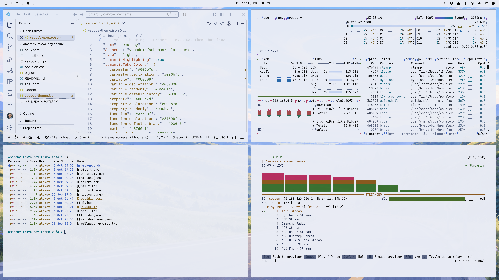

# Tokyo Day

A light [Omarchy](https://omarchy.org) theme based on Tokyo Night, with near-black
text, blue accents and soft blue-gray backgrounds.



## Install

```sh
omarchy theme install https://github.com/lexeko/omarchy-tokyo-day-theme
```

To switch back to it later, choose **Tokyo Day** in Omarchy's theme picker or run:

```sh
omarchy theme set tokyo-day
```

Tested on Omarchy 4.0.4.

## App setup

Omarchy applies the theme to the shell, terminals and supported applications.
Tokyo Day includes colors for VS Code, Obsidian, T3 Code, Helix, btop, Claude Code
and Pi, plus a matching tint for Chromium-based browsers.

- **Obsidian:** select **Omarchy** in Settings → Appearance once per vault.
- **T3 Code:** select **Omarchy** in the app's theme settings.

## Credits and license

Based on Omarchy's Tokyo Night theme and app templates. The wallpaper is a
daytime adaptation of Tokyo Night's winding-road image, made with image generation.

[MIT License](LICENSE).
